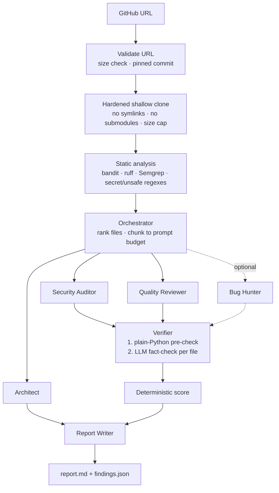

# Repo Reviewer

**A multi-agent AI code reviewer for public Python, JavaScript, TypeScript and Go repos, with a Verifier that removes hallucinated findings.**

Paste a GitHub URL. Specialist agents produce an architecture summary and security and code-quality findings. A
**Verifier** agent re-checks every finding against the actual code before the report is written, and the evals
measure how much that improves precision.

<!-- Demo GIF: record one review in the web app and save it as docs/demo.gif, then uncomment:

-->

**Live demo:** _not deployed yet_ (see [Deploy](#deploy-free)).

---

## How it works



- **One role per agent.** Each agent has one prompt and one pydantic output schema. Agents never talk to each other; only the orchestrator connects them.
- **Grounded findings.** Static-analysis hits are passed to the agents as evidence: bandit and ruff for Python, Semgrep's free rule packs for JavaScript, TypeScript and Go (`p/javascript`, `p/typescript`, `p/nodejsscan`, `p/golang`, `p/gosec`, chosen by the languages in the repo), and a regex secret scanner for every file. The LLM interprets the evidence but does not get to make up locations.
- **Two-stage Verifier.** The free plain-Python stage rejects a finding when the file doesn't exist, the line is out of range, or the quoted evidence isn't within ±3 lines of the cited line. The LLM stage then fact-checks whatever is left, with one batched call per file.
- **Deterministic score.** `100 − (10·high + 4·medium + 1·low)`, floored at 0 and computed in Python, never by the LLM. The report also shows findings per 1k LOC because the score is not size-aware.

## Results

Ten repos, each pinned to a commit: 4 deliberately vulnerable apps with 18 documented ("ground truth") issues, 4 clean
libraries and 2 real-world apps (see [evals/repos.json](evals/repos.json)). Labeling rules were written before the
first run ([evals/LABELING_RULES.md](evals/LABELING_RULES.md)). Both runs below used the same model,
`gemini-3.5-flash-lite`, so the difference comes from the code change, not the model.

| Run | Precision, no Verifier | Precision, with Verifier | Recall, no Verifier | Recall, with Verifier | Findings (raw → confirmed) |
|---|---|---|---|---|---|
| Baseline (pipeline v4) | 36% | 38% | 50% (9/18) | 44% (8/18) | 72 → 60 |
| **Quality agent fixed (v9)** | **71%** | **73%** | **61% (11/18)** | **50% (9/18)** | 35 → 30 |

_Per-repo numbers: [evals/results.md](evals/results.md) (baseline) and
[evals/results-quality-v2.md](evals/results-quality-v2.md) (v9). Regenerate with
`python -m evals.run_evals score [--tag quality-v2]`._

**What the first run showed.** The Security agent was already good (**83%** of its findings real), but the Quality
agent was mostly noise (**20%** real, 11 of 54). Its false findings were largely self-inflicted: the prompt asked for
missing docstrings, ruff's style and count rules (SIM, C901, PLR) were fed in as "evidence", and `--ignore-noqa` made
ruff report imports the authors had explicitly marked as intentional.

**What changed (v9).** The Quality agent now reports only problems with a concrete consequence (a bug, crash, leak,
hidden failure or likely mistake) and must state that consequence; style is explicitly out of scope. Ruff feeds only
bug rules (`F, E9, E722, B`) and respects inline `# noqa` (it never feeds the Security agent or the PR gate).

**Effect.** Quality precision rose from 20% to **58%**, overall precision roughly doubled (**36% → 71%**), and recall
went **up**, not down (9 → 11 of 18 planted issues): with less noise the agents found DVPWA's MD5 password hashing and
Vulnerable-Flask-App's unverified JWT, which the baseline missed. The Quality agent now finds real bugs, for example
`para` used after an empty loop, `e.message` crashing on Python 3, and `None` dereferences on missing records.

**The Verifier is still the weak part.** In both runs it adds only about 2 points of precision and costs recall: it
rejected real findings such as DSVW's login SQL injection (it saw the username is sanitized and missed the
unsanitized password). On this evidence it is not yet worth its extra time and calls. The next step is to give it
data-flow context (where each variable comes from) and to re-run on a stronger model.

**Caveats.** Labels were made by an AI assistant (Claude) at the owner's request, not by a blind human; every rule
applied is in [evals/LABELING_LOG.md](evals/LABELING_LOG.md) so they can be audited. All calls were answered by the
smallest free-tier model. Ten repos is a small sample, and LLM output varies between runs (the Security agent was
83% precise in the first run and 78% in the second). Average time per repo was 87 s in the baseline and 119 s in v9,
mostly because one repo hit free-tier rate limits (microblog: 564 s); the "No Verifier" columns are each run minus its
Verifier stage, not separate runs. The baseline runs predate per-run model recording; their `models_used` field was
added afterwards from the trace logs.

## Run locally (4 commands)

```bash
python -m venv .venv && source .venv/Scripts/activate   # macOS/Linux: source .venv/bin/activate
pip install -r requirements.txt
cp .env.example .env                                      # then add your free key from aistudio.google.com
streamlit run app.py                                      # or: python -m src.main https://github.com/pallets/itsdangerous
```

Command-line options: `--no-verify` (baseline), `--bug-hunter`, `--commit <sha>` and `--no-cache`. Reports are written to `reports/<owner>__<repo>/`.

## Evals

```bash
python -m evals.run_evals            # review all 10 pinned repos, then score
python -m evals.run_evals label      # blind, interactive labeling of every raw finding
python -m evals.run_evals score      # precision / recall / rejection rate -> evals/results.md + this README
python -m evals.run_evals run --bug-hunter --tag bughunter   # compare the optional Bug Hunter agent
```

A single run gives both configurations. The Verifier only removes findings, so **OFF = all raw findings** and **ON = confirmed findings**. Each finding is labeled once and the same label is used for both configurations.

## GitHub pull-request bot

Repo Reviewer also runs as a **GitHub Action**. On every pull request it reviews only the lines the PR changed:

- **Diff-aware:** only changed files are scanned and reviewed. The agents see each whole file for context, but they are told the changed line ranges, and only confirmed findings on changed lines become comments.
- **Inline comments on the diff**, posted as a single review, plus **one summary comment with the score** that is updated on every push instead of duplicated. Re-runs never post the same inline comment twice; a line-independent fingerprint survives later commits shifting the code.
- **Optional merge gate:** `fail-on: high` fails the check when a confirmed high-severity issue is introduced.
- **Job summary:** the same summary appears on the Actions run page.

Add it to any repository by creating `.github/workflows/repo-review.yml`:

```yaml
name: Repo Reviewer
on:
  pull_request:
permissions:
  contents: read
  pull-requests: write
jobs:
  review:
    runs-on: ubuntu-latest
    steps:
      - uses: actions/checkout@v4
        with:
          fetch-depth: 0
          ref: ${{ github.event.pull_request.head.sha }}
          persist-credentials: false
      - uses: <owner>/<this-repo>@<commit-sha>   # pin a commit, not a branch
        with:
          gemini-api-key: ${{ secrets.GEMINI_API_KEY }}
          fail-on: high   # optional: none (default), low, medium, high
```

Then add a `GEMINI_API_KEY` repository secret. **Security:** the `pull_request` trigger means pull requests from forks never receive the key: the bot reports them as not reviewed (and fails the check when `fail-on` is set) instead of exposing it. It refuses to run under `pull_request_target`. As a merge gate it fails closed: any changed file it could not fully review is listed and fails the check, and high-severity scanner hits on changed lines count even if the AI does not confirm them. Only the bot's own comments are trusted when it updates its summary or skips already-posted findings. Action inputs are passed through environment variables, never interpolated into shell commands. Comment text is escaped, so it cannot `@mention` people or inject links.

**Tested on a real pull request:** in [dental-clinic-website PR #1](https://github.com/Waleedkhan455/dental-clinic-website/pull/1)
the workflow ran on GitHub Actions with the `GEMINI_API_KEY` secret, reviewed the one changed file and posted the summary
comment (score 100/100). That change introduced no issues, so inline comments have so far been verified only locally
against the live LLM (both injected vulnerabilities reported on the exact changed lines) and in the test suite.

Try it locally without posting anything:

```bash
python -m src.pr_review --repo-dir <path-to-repo> --base <base-sha> --head <head-sha> --dry-run
```

## Design decisions

- **Plain Python, no agent framework.** The pipeline is a set of plain functions in [src/orchestrator.py](src/orchestrator.py), with parallelism from `ThreadPoolExecutor`. Every step can be explained line by line. A framework would add abstraction without adding capability for a fixed pipeline like this one.
- **Why a Verifier.** LLM reviewers invent line numbers, quote code that doesn't exist, and flag safe code. A cheap Python pre-check catches the mechanical hallucinations for free. A skeptical second LLM pass catches the plausible but wrong ones. The evals measure the effect.
- **Why deterministic scoring.** The same findings always give the same score, and the formula is in the report.
- **Why caching by commit SHA.** Free-tier quota is the scarcest resource. A repo that hasn't changed is never reviewed twice. The cache key includes the model and prompt version, so changing either never serves a stale report.

## Security model

The app clones attacker-controlled code, runs tools on it and holds an API key. It treats every byte of the cloned repo as hostile.

| Threat | Control |
|---|---|
| Malicious URL (`github.com.evil.io`, `ext::`, `--upload-pack`) | Strict `fullmatch` regex; the clone URL is rebuilt from validated parts and passed after `--` |
| Symlink to `../../.env` leaking the API key | `core.symlinks=false`, symlinks skipped, `realpath` must stay inside the clone |
| Planted `bandit/__main__.py` hijacking the scanner | Scanners run with `python -I` from a neutral directory; ruff runs as its binary |
| Repo config silencing scanners (`.bandit`, `pyproject.toml`, `# nosec`, `// nosemgrep`, `.semgrepignore`) | Our own bandit ini, `ruff --isolated`, `--ignore-nosec`, Semgrep `--disable-nosem` and `.semgrepignore` ignored. Inline `# noqa` is respected for ruff only, which feeds Quality hints, never the Security agent or the PR gate |
| Zip-bomb-like repos, submodules, LFS | GitHub API size check, then `ls-tree` unpacked-size check **before** checkout; no submodules; LFS smudge off |
| Secrets reaching child processes | `.env` is read without touching `os.environ`; subprocess environments are stripped of keys and tokens |
| Prompt injection in code or file names | Content is wrapped in per-run random-nonce tags and marked untrusted; unsafe file names are skipped; the Verifier pre-check rejects invented findings |
| Hung git or scanners | Hard timeouts that kill the whole process tree |
| Scanner memory exhaustion (crafted files that make Semgrep use ~10 GB) | Semgrep scans only the listed first-party files, with a 50 KB per-file cap, one job and `--max-memory`; peak measured at 306 MB on the attack fixture |
| Prompt injection through scanner output (Semgrep copies matched code into its messages) | Only the rule ID and the rule's CWE text are passed on; tool evidence is also wrapped in nonce tags and marked untrusted |
| Hiding real code as a "vendored library" or a "test" | Skipping a file as vendored needs two signals (asset folder plus library name or minified shape, or a `.min` name plus minified shape); tests are recognized only by conventional names and folders; test files with scanner hits still go to Security; every skipped file is listed in the report |
| Quota abuse on the public app | Global daily cap (refunded when a run fails before any LLM call), concurrency caps on reviews and cache lookups, a per-client cooldown that survives reloads; cached results are free; partial reviews are never cached |
| Markdown injection in shared reports | All LLM and repo prose is escaped (no links, images or HTML), code fences are longer than any backtick run inside, and `unsafe_allow_html` is never used |
| Leaking found secrets | Secrets are masked in report.md and findings.json |

Nothing from the reviewed repo is ever imported or executed.

## What failed and what I changed

These all happened while building this project.

1. **The baseline was quietly flattering itself.** The first version dropped findings that cited files the agent hadn't been shown, before they reached the Verifier. That hid hallucinations from the "No Verifier" numbers. Now every raw finding reaches the Verifier, whose pre-check rejects and counts it.
2. **The security scanner could be hijacked by the code it scanned.** `python -m bandit` was run from inside the clone, and Python puts the current directory first on `sys.path`. A repo containing `bandit/__main__.py` would have run its own code on the server. A security-review agent caught this. The fix is `python -I`, a neutral working directory and calling ruff's binary directly, plus a regression test that plants exactly this attack.
3. **Timeouts didn't time out on Windows.** `subprocess.run(timeout=…)` kills only the direct child. When `git clone` starts `git-remote-https`, the grandchild keeps the pipes open and the call blocks past the deadline. Commands now run in their own process group, and the whole tree is killed on timeout.
4. **`--filter=blob:limit` doesn't limit size.** Checkout lazily downloads the filtered blobs anyway. Now one commit is shallow-fetched into an empty repo without checking it out. Its blob sizes are summed with `ls-tree` on `FETCH_HEAD`, and it is refused above the cap before any file is written.
5. **Strict evidence matching rejected real findings.** Exact snippet matching failed on tabs and spaces, CRLF line endings and line-number prefixes copied from the prompt. Matching now normalizes whitespace and strips those prefixes, and short snippets like `eval(s)` must equal a whole line.
6. **The eval was crediting the Verifier for work it didn't do.** Cross-agent duplicate removal ran after verification, so the "No Verifier" baseline counted duplicates that the "With Verifier" row didn't. Both rows now apply the same duplicate removal, the rejection rate counts only real Verifier rejections, and the baseline's cost excludes the Verifier stage.
7. **One failed agent call poisoned the cache.** A review in which one agent hit a rate limit was cached under the commit like a complete one, so every later visitor got the partial report. Reviews with any failed agent call, Architect fallback or scanner failure are now marked `degraded` and never cached.

8. **One malformed character lost a whole batch of security findings.** On the first JavaScript repo, the model put a raw tab inside a JSON string. Python's strict JSON parser rejected the reply, so a Security batch failed and the report showed no vulnerabilities for an app full of them. JSON is now parsed leniently, and the same repo went from 0 to 6 confirmed vulnerabilities, matching the ones it documents.
9. **Reviewing jQuery as if it were the project's code.** On a Go repo, review batches were spent on bundled `jquery-3.2.1-min.js` and `bootstrap.js`. Vendored and minified assets are now detected by name and by line length and skipped, which cut the reviewed code from 3,978 to 1,596 lines.

## Limitations

- Python, JavaScript, TypeScript and Go. Other languages get regex checks only. Bundled third-party front-end libraries (jQuery, Bootstrap, minified bundles) are skipped because they are not the project's own code.
- Semgrep downloads its free rule packs from semgrep.dev at scan time; if that fails, the report says static analysis was degraded.
- Every selected file is reviewed in successive small batches (up to 200 files and 20 batches per agent, so one huge repo cannot use up the free daily quota). Anything beyond that, and the unreviewed part of very large files, is listed in the report.
- Free-tier rate limits make a fresh review take one to a few minutes.
- The Verifier is itself an LLM. It can wrongly confirm or wrongly reject a finding, which is why it is measured rather than trusted.

## Deploy (free)

1. Push this repo to GitHub. `.env` and `.streamlit/secrets.toml` are git-ignored; never commit them.
2. On [Streamlit Community Cloud](https://share.streamlit.io), create an app from the repo with main file `app.py` and,
   under **Advanced settings**, Python 3.12.
3. In **Secrets**, add `GEMINI_API_KEY = "..."`. Strongly recommended: also add `GITHUB_TOKEN = "..."` (a fine-grained
   token with no permissions is enough). Without it the repo-size check uses GitHub's anonymous limit of 60 requests
   per hour, shared by everyone on the host. Optional: `RR_APP_DAILY_RUN_CAP`.
4. `packages.txt` installs `git`. Keep git up to date on any other host.
5. Logs and the review cache go to the project folder, or to the system temp folder if that is read-only
   (override with `RR_DATA_DIR`). On Community Cloud they reset when the app restarts.

## Project layout

```
app.py                  Streamlit UI (rate limits, cache-first, trace viewer)
src/service.py          public API used by the CLI, web app, PR bot, evals (and a future MCP server)
src/main.py             CLI
src/changes.py          diff-aware review of changed lines (used by the PR bot)
src/pr_review.py        GitHub pull-request bot (diff-aware review, inline comments, merge gate)
src/diffs.py            changed lines of a PR from `git diff`
src/github_api.py       minimal GitHub REST client
action.yml              the reusable GitHub Action
.github/workflows/      CI (lint + tests) and the PR bot on this repo
src/orchestrator.py     plan -> agents (parallel) -> verify -> dedupe -> score -> report
src/agents/             architect, security, quality, bug_hunter, verifier, writer, shared runner
src/repo.py             URL validation, hardened clone, safe file listing
src/proc.py             bounded subprocesses (tree kill, secret-free env)
src/tools/              bandit/ruff runners, regex scanner
src/llm.py              the only module that talks to the LLM (throttle, retries, 429 handling)
src/cache.py            commit-keyed review cache
prompts/                one prompt per agent
evals/                  pinned repos, labeling rules, harness
tests/                  pytest suite; no network or LLM needed
```

## Future work

- More languages (Java, Ruby) via further Semgrep rule packs.
- A local model (Ollama) as a second column in the eval table.
- A fix-suggestion agent that proposes diffs, with a human approval step.
